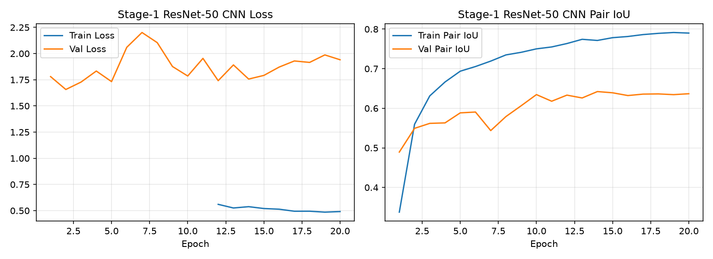
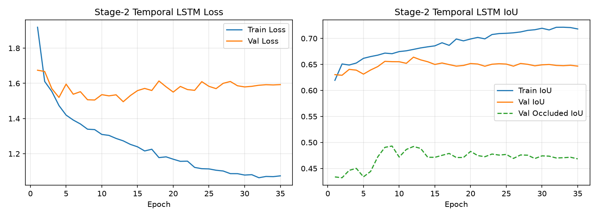
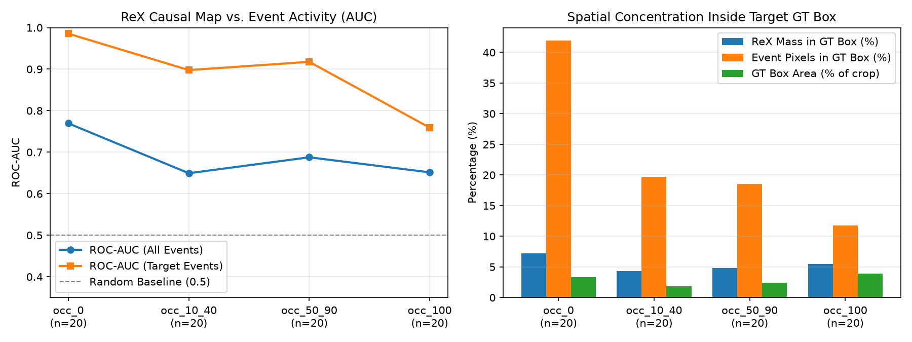
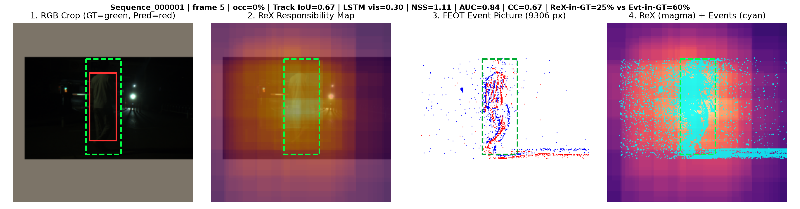

# RGB Tracking & explainability through ResNet-50 + LSTM + ReX vs. Event Pictures

An end-to-end 3-stage study on a stratified **100-sequence subset of the FEOT dataset (`FEOT_100`, 18,526 pixel-aligned RGB + Event frames)**:
1. **Stage 1 (`src/train_cnn.py`)**: fine-tune an ImageNet-pretrained **ResNet-50** spatial tracker on FEOT
2. **Stage 2 (`src/train_lstm.py`)**: Attach a 2layer **Temporal LSTM** with visibility-gated visual-motion fusion on top of frozen ResNet-50 CNN & train on temporal clips with synthetic  occluders.
3. **Stage 3 (`src/run_rex_eval.py` & `src/compare_rex_stage1_vs_stage2.py`)**: Use **ReX** to compute causal responsibility maps on unseen test RGB frames (with LSTM hidden state) and compare them with FEOT's pixel-aligned **event-camera pictures** across all occlusion.

---

## Dataset Split (`FEOT_100`)

The exact sequence lists and metadata are tracked in `data/FEOT_100/` (`train_list.txt`, `val_list.txt`, `test_list.txt`, `metadata.tsv`), curated from [`DongHappyyy/FEOT`](https://huggingface.co/datasets/DongHappyyy/FEOT) (`1070 × 610` pixel-aligned RGB + Event PNGs; raw PNG frames excluded from Git):

| Split | Sequences | Official Source | Frames | Full Occ (`100`) | Partial Occ (`50–90`) | Low Occ | Categories |
| :--- | :---: | :--- | :---: | :---: | :---: | :---: | :---: |
| **Train** | 70 | `train_list.txt` | 12,630 | 31 | 25 | 14 | 10 |
| **Val** | 10 | `train_list.txt` *(disjoint)* | 2,022 | 5 | 3 | 2 | 5 |
| **Test** | 20 | `test_list.txt` | 3,874 | 10 | 6 | 4 | 9 |
| **Total** | **100** | | **18,526** | **46** | **34** | **20** | **10** |

---

## Results Summary

### 1. Stage 1 (ResNet-50 CNN) vs. Stage 2 (ResNet-50 + LSTM) — Unseen TEST Split (20 seqs, 3,874 frames)

| Occlusion Regime | Frames | Stage-1 CNN IoU | Stage-2 CNN+LSTM IoU | Stage-1 Prec@20px | Stage-2 Prec@20px |
| :--- | :---: | :---: | :---: | :---: | :---: |
| **Overall** | 3,874 | `0.4029` | `0.3908` (`-0.012`) | `56.7%` | **`57.0%`** (`+0.3%`) |
| **`occ = 0`** *(visible)* | 1,973 | `0.6092` | **`0.6123`** (`+0.003`) | `83.6%` | `83.2%` |
| **`occ 10–40`** *(light)* | 1,063 | `0.2757` | `0.2297` (`-0.046`) | `40.5%` | `37.0%` |
| **`occ 50–90`** *(heavy)* | 557 | `0.1082` | `0.0874` (`-0.021`) | `19.4%` | **`23.9%`** (`+4.5%`) |
| **`occ = 100`** *(full)* | 281 | `0.0202` | **`0.0461`** (**2.3×**) | `2.8%` | **`14.6%`** (**5.1×**) |

| Stage-1 ResNet-50 CNN Curves | Stage-2 Temporal LSTM Curves |
| :---: | :---: |
|  |  |

---

### 2. Stage 3: ReX Causal Responsibility Maps vs. FEOT Event Pictures (80 Unseen Test Frames)

| Occlusion Regime | Frames | NSS *(>0 = above chance)* | ROC-AUC *(All Events)* | ROC-AUC *(Target Events)* | Pearson CC | SIM | Top-20% IoU | ReX in GT vs. Evt in GT |
| :--- | :---: | :---: | :---: | :---: | :---: | :---: | :---: | :---: |
| **Overall** | 80 | **`+0.956`** | **`0.690`** | **`0.890`** | `+0.356` | `0.463` | `0.219` | `5.4%` vs. `23.0%` |
| **`occ = 0`** | 20 | **`+1.558`** | **`0.769`** | **`0.985`** | **`+0.470`** | `0.409` | `0.221` | `7.2%` vs. `42.0%` |
| **`occ 10–40`** | 20 | `+0.867` | `0.649` | `0.898` | `+0.333` | `0.452` | `0.191` | `4.3%` vs. `19.7%` |
| **`occ 50–90`** | 20 | `+0.873` | `0.688` | `0.918` | `+0.369` | `0.467` | `0.217` | `4.8%` vs. `18.5%` |
| **`occ = 100`** | 20 | **`+0.528`** | **`0.652`** | **`0.759`** | **`+0.250`** | `0.526` | `0.247` | `5.5%` vs. `11.8%` |



---

### 3. Controlled Ablation: Stage-1 (CNN Only) vs. Stage-2 (CNN + LSTM) ReX Maps (40 Identical Frames)

| Regime | Frames | ReX(S1) vs. ReX(S2) CC | NSS (`S1 → S2`) | All-Event AUC (`S1 → S2`) | Target-Event AUC (`S1 → S2`) |
| :--- | :---: | :---: | :---: | :---: | :---: |
| **Overall** | 40 | `+0.730` | `+0.73 → +0.70` | `0.667 → 0.658` | `0.931 → 0.869` |
| **`occ = 0`** | 10 | **`+0.882`** | `+1.17 → +1.17` | `0.717 → 0.717` | `0.971 → 0.966` |
| **`occ 10–40`** | 10 | `+0.764` | `+0.61 → +0.54` | `0.642 → 0.621` | `0.983 → 0.886` |
| **`occ 50–90`** | 10 | `+0.818` | `+0.65 → +0.70` | `0.659 → 0.674` | `0.961 → 0.946` |
| **`occ = 100`** | 10 | **`+0.456`** | `+0.49 → +0.40` | `0.650 → 0.620` | `0.808 → 0.678` |


- **Key Finding:** When targets are visible (`occ = 0`), CNN-only and CNN+LSTM produce nearly identical ReX maps (`S1–S2 CC = +0.882`) closely matching the event camera (`TargetEvt-AUC = 0.97`). Under full occlusion (`occ = 100`), `S1–S2 CC` drops to `+0.456`: CNN-only is forced to rely on noisy current-frame RGB pixels, whereas CNN+LSTM shifts causal reliance onto its temporal hidden state — boosting full-occlusion `Prec@20px` by **5.1×** while decoupling from unreliable current-frame RGB appearance.

#### Sample Visual Panels



---

## Repository Structure

```text
feot-rex/
├── checkpoints/
│   ├── resnet50_cnn_best.pt          # Stage-1 ResNet-50 RGB CNN (Epoch 14)
│   └── resnet50_lstm_best.pt         # Stage-2 Unified ResNet-50 + LSTM (Epoch 12)
├── data/FEOT_100/
│   ├── train_list.txt                # 70 train sequences
│   ├── val_list.txt                  # 10 validation sequences
│   ├── test_list.txt                 # 20 test sequences
│   └── metadata.tsv                  # Per-sequence stats (frames, category, occlusion, FPS)
├── outputs/
│   ├── stage1_cnn_eval.json          # Stage-1 metrics & per-sequence results
│   ├── stage1_cnn_curves.png         # Stage-1 training curves
│   ├── stage2_lstm_eval.json         # Stage-2 metrics & per-sequence results
│   ├── stage2_lstm_curves.png        # Stage-2 training curves
│   ├── rex_eval/                     # Stage-3 80-frame ReX vs Event metrics, chart & 16 panels
│   └── rex_compare/                  # 40-frame Stage-1 vs Stage-2 ReX ablation metrics, chart & 8 panels
├── src/
│   ├── feot_dataset.py               # FEOT dataset loader & invertible crop geometry
│   ├── losses.py                     # fp32 GIoU + L1 + Gaussian Focal Heatmap loss
│   ├── models.py                     # ResNet50TrackerCNN, TemporalLSTMHead, ResNet50LSTMTracker
│   ├── train_cnn.py                  # Stage-1 training & online sequential tracking eval
│   ├── train_lstm.py                 # Stage-2 LSTM training & online sequential tracking eval
│   ├── run_rex_eval.py               # Stage-3 ReX causal maps vs FEOT event pictures
│   └── compare_rex_stage1_vs_stage2.py
└── requirements.txt
```

## Reproducing the Pipeline

Place the downloaded FEOT sequence folders under `data/FEOT_100/FEOT_dataset/` matching `train_list.txt`, `val_list.txt`, and `test_list.txt`, then run:

```bash
# 1. Install dependencies (install CUDA PyTorch matching your GPU first)
pip install -r requirements.txt

# 2. Stage 1 — Train ResNet-50 RGB CNN
python src/train_cnn.py --epochs 20 --batch_size 48 --samples_per_epoch 4200

# 3. Stage 2 — Attach & Train Temporal LSTM
python src/train_lstm.py --epochs 35 --batch_size 32 --clip_len 24

# 4. Stage 3 — Generate ReX Responsibility Maps & Compare Against Event Pictures
python src/run_rex_eval.py --max_per_bucket 20 --rex_iters 20 --rex_batch 16

# 5. Controlled Stage-1 vs Stage-2 ReX Comparison
python src/compare_rex_stage1_vs_stage2.py --max_per_bucket 10 --rex_iters 16 --rex_batch 16
```
