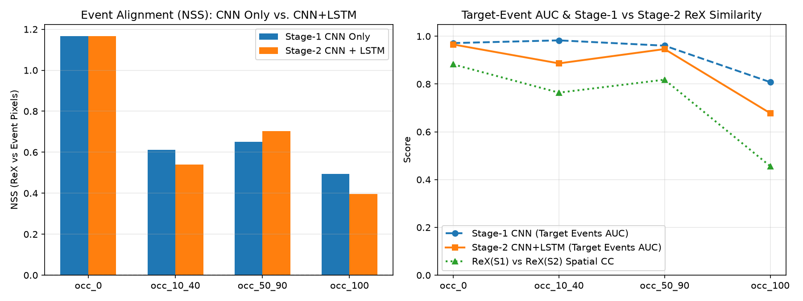
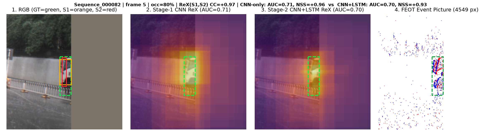
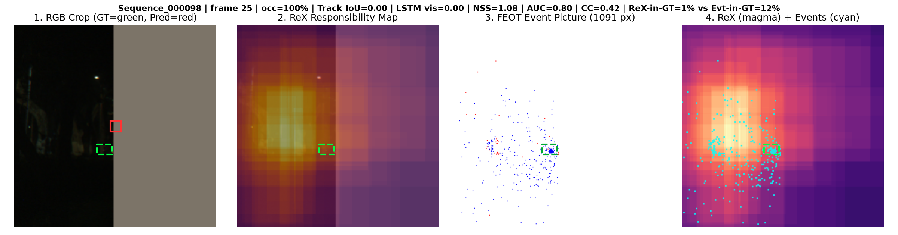

# RGB Tracking & explainability through resnet-50 + LSTM + ReX vs. Event Pictures

1. **Step 1 (`src/train_cnn.py`)**: Fine-tune an imagenet-pretrained resnet-50 tracker on FEOT RGB frames.
2. **Step 2 (`src/train_lstm.py`)**: Attach a 2-layer LSTM on top of the frozen resnet-50 backbone.
3. **Step 3 (`src/run_rex_eval.py`, `src/compare_rex_stage1_vs_stage2.py`)**: Compute ReX responsibility maps on test RGB frames and compare them with FEOT event pictures.

## Dataset

100-sequence subset (70 train / 10 val / 20 test, 18,526 frames) from [`DongHappyyy/FEOT`](https://huggingface.co/datasets/DongHappyyy/FEOT) ([feot-dataset.github.io](https://feot-dataset.github.io/)). Sequence lists are in `data/FEOT_100/`.

## Results

### Step 1 (resnet-50) vs. Step 2 (resnet-50 + LSTM) — Test Split (20 seqs, 3,874 frames)

| Occlusion | Frames | Step 1 IoU | Step 2 IoU | Step 1 Prec@20px | Step 2 Prec@20px |
| :--- | :---: | :---: | :---: | :---: | :---: |
| **Overall** | 3,874 | `0.4029` | `0.3908` | `56.7%` | **`57.0%`** |
| `occ = 0` | 1,973 | `0.6092` | **`0.6123`** | `83.6%` | `83.2%` |
| `occ 10–40` | 1,063 | `0.2757` | `0.2297` | `40.5%` | `37.0%` |
| `occ 50–90` | 557 | `0.1082` | `0.0874` | `19.4%` | **`23.9%`** |
| `occ = 100` | 281 | `0.0202` | **`0.0461`** | `2.8%` | **`14.6%`** |

| Step 1 (resnet-50) | Step 2 (LSTM) |
| :---: | :---: |
|  |  |

### Step 3: ReX vs. Event Pictures (80 Test Frames)

| Occlusion | Frames | NSS | ROC-AUC (All) | ROC-AUC (Target) | CC | SIM | Top-20% IoU | ReX / Evt in GT |
| :--- | :---: | :---: | :---: | :---: | :---: | :---: | :---: | :---: |
| **Overall** | 80 | `+0.956` | `0.690` | `0.890` | `+0.356` | `0.463` | `0.219` | `5.4%` / `23.0%` |
| `occ = 0` | 20 | `+1.558` | `0.769` | `0.985` | `+0.470` | `0.409` | `0.221` | `7.2%` / `42.0%` |
| `occ 10–40` | 20 | `+0.867` | `0.649` | `0.898` | `+0.333` | `0.452` | `0.191` | `4.3%` / `19.7%` |
| `occ 50–90` | 20 | `+0.873` | `0.688` | `0.918` | `+0.369` | `0.467` | `0.217` | `4.8%` / `18.5%` |
| `occ = 100` | 20 | `+0.528` | `0.652` | `0.759` | `+0.250` | `0.526` | `0.247` | `5.5%` / `11.8%` |

### Comparison: Step 1 (CNN) vs. Step 2 (CNN + LSTM) ReX Maps (40 Identical Frames)

| Occlusion | Frames | Step1–Step2 CC | NSS (S1 → S2) | All-Event AUC (S1 → S2) | Target-Event AUC (S1 → S2) |
| :--- | :---: | :---: | :---: | :---: | :---: |
| **Overall** | 40 | `+0.730` | `+0.73 → +0.70` | `0.667 → 0.658` | `0.931 → 0.869` |
| `occ = 0` | 10 | `+0.882` | `+1.17 → +1.17` | `0.717 → 0.717` | `0.971 → 0.966` |
| `occ 10–40` | 10 | `+0.764` | `+0.61 → +0.54` | `0.642 → 0.621` | `0.983 → 0.886` |
| `occ 50–90` | 10 | `+0.818` | `+0.65 → +0.70` | `0.659 → 0.674` | `0.961 → 0.946` |
| `occ = 100` | 10 | `+0.456` | `+0.49 → +0.40` | `0.650 → 0.620` | `0.808 → 0.678` |

### Sample Panels

