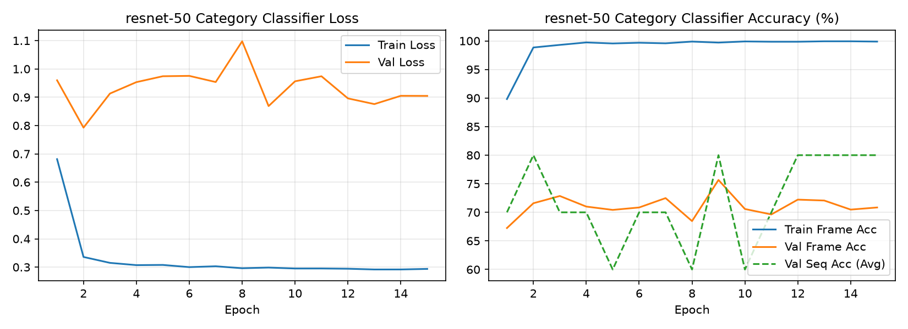
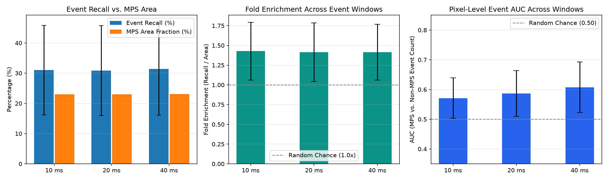
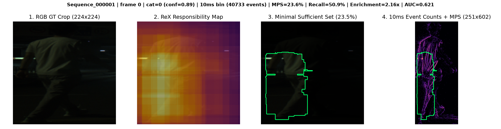
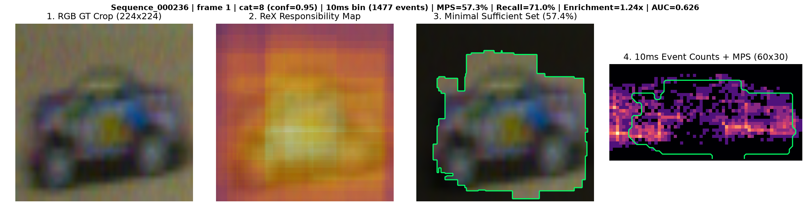
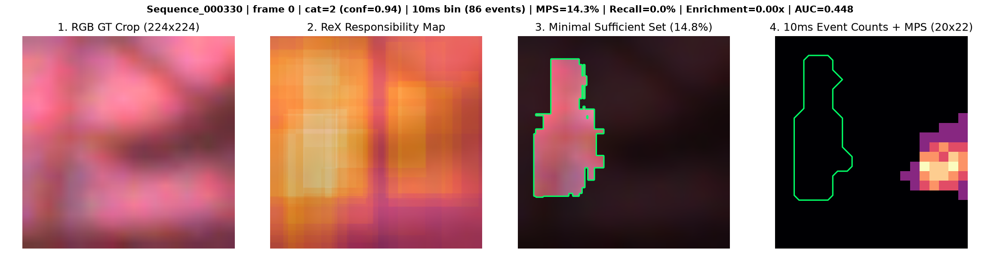
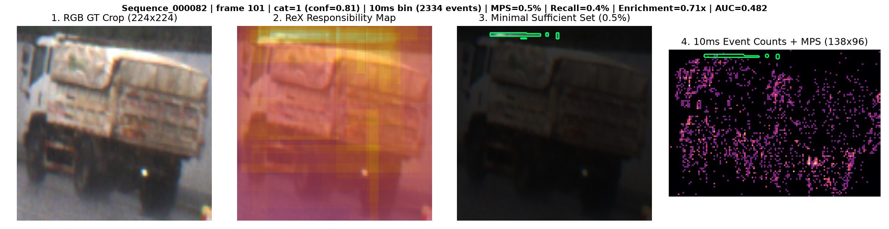

# RGB Classification & explainability through resnet-50 + ReX vs. Event Data

1. **Step 1 (`src/train_classifier.py`, `src/eval_classifier_prf.py`)**: Fine-tune an imagenet-pretrained resnet-50 classifier on annotated FEOT RGB bounding-box crops (sequence-disjoint split, fully occluded frames excluded from training; sequence-level prediction = average of frame-level probabilities).
2. **Step 2 (`src/run_rex_mps.py`)**: Center fixed raw event windows (`10 ms`, `20 ms`, `40 ms`) from `aligned_event.h5` around each RGB frame timestamp inside the native crop pixel grid.
3. **Step 3 (`src/run_rex_mps.py`)**: Run ReX per frame on up to 10 unoccluded (`occ = 0`), correctly classified frames per test sequence to extract the binary Minimal Sufficient Pixel Set (MPS).
4. **Step 4 (`src/run_rex_mps.py`)**: Score MPS vs. raw event counts with Event Recall, Fold Enrichment, and Pixel AUC (averaged within each sequence first, then across sequences).

## Dataset

100-sequence subset (`70 train / 10 val / 20 test`, `18,526` frames across 10 categories) from [`DongHappyyy/FEOT`](https://huggingface.co/datasets/DongHappyyy/FEOT) ([feot-dataset.github.io](https://feot-dataset.github.io/)), plus raw microsecond-aligned `aligned_event.h5` streams for all 20 test sequences (`352.7M` events). Sequence lists are in `data/FEOT_100/`.

## Results

### Step 1: resnet-50 GT-Box Category Classifier

| Split & Evaluation Level | Accuracy | Macro P / R / F1 | Weighted P / R / F1 |
| :--- | :---: | :---: | :---: |
| **Val — Frame (`occ < 100`, 1,890)** | `75.7%` | `66.1% / 65.6% / 65.0%` | `78.0% / 75.7% / 75.8%` |
| **Val — Unoccluded (`occ = 0`, 909)** | `90.9%` | `74.6% / 90.5% / 69.8%` | `98.5% / 90.9% / 93.9%` |
| **Val — Sequence (avg probs, 10 seqs)** | `80.0%` | `73.3% / 70.0% / 69.3%` | `83.3% / 80.0% / 79.3%` |
| **Test — Frame (`occ < 100`, 3,593)** | **`89.5%`** | **`93.6% / 83.4% / 84.6%`** | **`91.2% / 89.5% / 89.0%`** |
| **Test — Unoccluded (`occ = 0`, 1,973)** | **`98.2%`** | **`99.1% / 95.6% / 97.2%`** | **`98.3% / 98.2% / 98.2%`** |
| **Test — Sequence (avg probs, 20 seqs)** | **`90.0%`** | **`87.0% / 85.2% / 85.7%`** | **`90.8% / 90.0% / 89.7%`** |

### Steps 2–4: ReX MPS vs. Centered Event Windows

- **Exclusions:** `20` test sequences (`3,874` frames) → `5` sequences (`1,901` frames) excluded with no `occ = 0` frames → `1` sequence (`35` frames) excluded with no correctly classified `occ = 0` frames → `14` test sequences (`134` sampled frames, `0` degenerate MPS masks, `1` low-event frame `< 20` events skipped at `10 ms` and `20 ms`).
- **Overlap Metrics** (within-sequence mean → across-sequence mean over `14` sequences; one-sided Wilcoxon signed-rank `p`-values vs. random chance):

| Event Window | Scored (Seqs / Frames) | Mean MPS Area | Event Recall | Fold Enrichment (`1.0x` = chance) | Pixel AUC (`0.50` = chance) |
| :--- | :---: | :---: | :---: | :---: | :---: |
| **`10 ms`** (`±5 ms`) | 14 / 133 | `23.0%` | `31.0% ± 14.8%` | **`1.43x ± 0.37`** (`p = 0.0006`) | **`0.571 ± 0.068`** (`p = 0.0020`) |
| **`20 ms`** (`±10 ms`) | 14 / 133 | `23.0%` | `30.9% ± 14.9%` | **`1.41x ± 0.37`** (`p = 0.0006`) | **`0.586 ± 0.077`** (`p = 0.0006`) |
| **`40 ms`** (`±20 ms`) | 14 / 134 | `23.1%` | `31.4% ± 15.4%` | **`1.42x ± 0.35`** (`p = 0.0006`) | **`0.607 ± 0.085`** (`p = 0.0006`) |

`12 / 14` test sequences exceed random chance on both Fold Enrichment (`> 1.0x`) and Pixel AUC (`> 0.50`).

### Sample Panels

